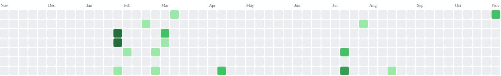

<h2 align="left">
A Cairo-based game developer building multiplayer systems, VR tooling, and small playable things that actually feel good to play.
</h2>

  
  
  
  
  
  
  
  
  
  
  
  
  
  
  
  
  
  
  
  
  

 

  
  
  

 

  
  
  

---

### 🕹️ What I Build

* **Multiplayer Systems:** Network synchronization, server-authoritative logic, and lag-compensated mechanics.
* **VR Comfort & Interaction:** Head motion stabilization, spatial interfaces, and player comfort tooling.
* **Gameplay Architecture & Jams:** Tight gameplay loops, custom shaders, and responsive character controllers.

---

### 🎮 Featured Projects

| Project | Status | Tech / Focus | Link |
| :--- | :--- | :--- | :--- |
| **Ipse** | Jammed | 1st Place ITI Game Jam 2026 • Narrative & Atmosphere | [itch.io](https://youstinamitsho.itch.io/ipse) |
| **LEGO Legends** | Shipped | First-person narrative quest & Atmospheric storytelling | [itch.io](https://youstinamitsho.itch.io/lego-legands) |
| **Kemet** | Shipped | Two-Agent DRL Adaptive Systems | [Details](https://youstinamitsho.github.io/Portfolio/game.html?slug=kemet) |
| **Before 3:00 am** | Jammed | GMTK 2026 • Tense survival game | [itch.io](https://dianarehan.itch.io/before-3-am) |
| **Tankers** | Shipped | Multiplayer Netcode, 20 Concurrent Players | [Repository](https://github.com/YoustinaMitsho/Tankers) |

 

  ✨ Explore the full interactive catalog on <a href="https://youstinamitsho.github.io/Portfolio/"><b>Youstina.dev</b></a>

---

  <h2>🕹️ Profile Arcade: Tetris</h2>
  
  <picture>
    <source media="(prefers-color-scheme: dark)" srcset="https://raw.githubusercontent.com/YoustinaMitsho/YoustinaMitsho/output/tetris-contribution-graph-dark.svg">
    <source media="(prefers-color-scheme: light)" srcset="https://raw.githubusercontent.com/YoustinaMitsho/YoustinaMitsho/output/tetris-contribution-graph.svg">
    
  </picture>

